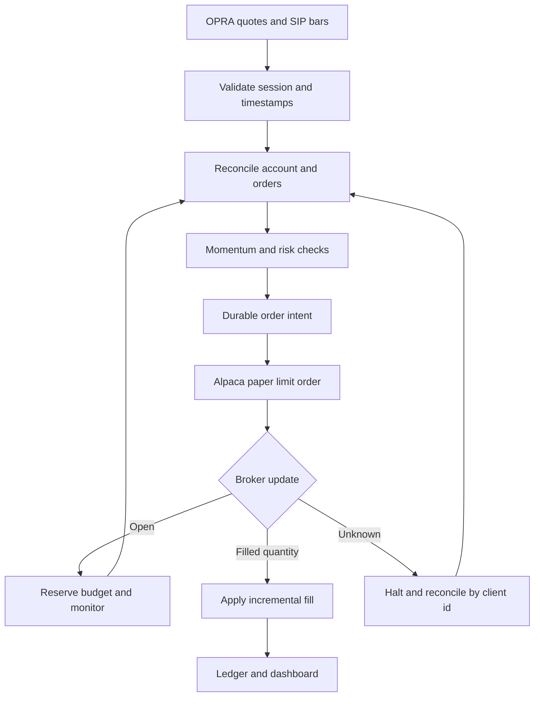

# Architecture

The application has two explicit execution backends sharing the momentum strategy, full premium sizing rules and market snapshot format. Local demo and replay never make brokerage orders. Alpaca paper mode persists an intent and waits for broker confirmed fills.

## Execution boundary

AlpacaPaper exposes a small endpoint allowlist for reading account state and order status, submitting day limit orders, and canceling a specific known order. The URL host is literal paper-api.alpaca.markets. Redirects are blocked. Only standard SPY and QQQ option symbols, whole contract quantities, buy to open and sell to close payloads are allowed. The code contains no real money order transport.

The factory selects PaperEngine for the dashboard, live runner and account check by default. Local demo and historical replay reject broker execution. Each database records its backend so local simulated fills cannot contaminate a broker confirmed ledger.

## Account ownership

The first connection binds a database to a paper account id. A different id cannot reuse it. A per account advisory file lock prevents simultaneous controllers on this computer, including controllers using different databases. This is not a distributed lock and does not coordinate other computers or manual activity.

Every cycle reconciles tracked order receipts and broker positions. A new fill can race a positions request, so the app retries the read sequence before declaring a mismatch. Unmanaged orders or unexplained positions latch a halt. The bot does not cancel or liquidate manual account activity.

## Intent and confirmation boundary

Each order intent has a deterministic client id, payload, requested quantity, submission attempt flag, broker status and last accounted cumulative filled quantity and notional. The attempt flag commits before submission. An ambiguous timeout cannot cause another POST for that intent. Reconnection looks up the same client id. An unresolved not found result causes a halt rather than an assumed rejection.

An accepted order leaves the strategy cash and position ledger unchanged while reserving its remaining premium and modeled fees. Confirmed quantity increments update cash and the position. Repeated cumulative confirmations have no additional effect. Partial exits allocate proportional position cost and realize only the new confirmed sale quantity. Strategy accounting retains the original modeled fee assumption.

A working entry cannot overlap a new entry. A position with a still unresolved entry cannot be closed until the entry has reached a terminal state. A pending entry is requested canceled after a halt, a position exit trigger, or sixty seconds. A pending exit is requested canceled after thirty seconds. Only after terminal confirmation may a later frame create a new closing limit at a current bid. No blind order replacement is implemented.

## Risk and market time

The strategy budget is independent of broker account size. Full premium and modeled round trip fees must fit the position, exposure, remaining daily loss and available cash budgets. Open entry reservations block additional entries and appear in exposure. Maximum entry attempts include rejections and cancellations.

Frames must be current for the broker backend and carry OPRA quotes. Historical and synthetic input is rejected. The broker clock is checked again immediately before a POST, and stale quotes or a closed market cancel the unsent local intent. Data quality errors block new entries and preserve position state.

Loss and stop thresholds are exit requests, not guaranteed loss ceilings. Network failure or a nonmarketable limit can prevent closure. Broker exercise, assignment, manual trades or fee corrections that break the expected ledger require inspection; the app does not invent reconciling trades.

## Local UI and worker

The loopback HTTP dashboard owns one quote worker and opens independent SQLite connections for consistent account reads. It shows the selected execution backend, strategy budget equity, actual quote previews, open positions, durable broker order status and decision events. Credential files are never served. Controls require a local Host, a local Origin when supplied, and a request token.

Synthetic scenarios use separate local databases. They cannot make broker orders or hide an active real quote worker. Halts persist and reconnecting does not clear them. A running worker continues requesting the quotes needed for exits. Process shutdown attempts reconciliation and entry cancellation, but it cannot promise cancellation or liquidation if the network is unavailable.

## Persistence and scope

SQLite commits account changes and fill events atomically. Durable client ids protect the boundary between committed intent and external API effects. Snapshot id hashes prevent duplicate input processing. Configurations are bound to the database.

This implementation uses REST polling. It is a local single operator paper trading tool, not a hosted multiuser trading service. Stream recovery, remote monitoring, exercise instructions, fee corrections and real money execution are not implemented.

Primary protocol references:

1. [Paper order API](https://docs.alpaca.markets/us/reference/postorder)
2. [Client id lookup](https://docs.alpaca.markets/us/reference/getorderbyclientorderid)
3. [Options permissions](https://docs.alpaca.markets/us/docs/options-trading)
